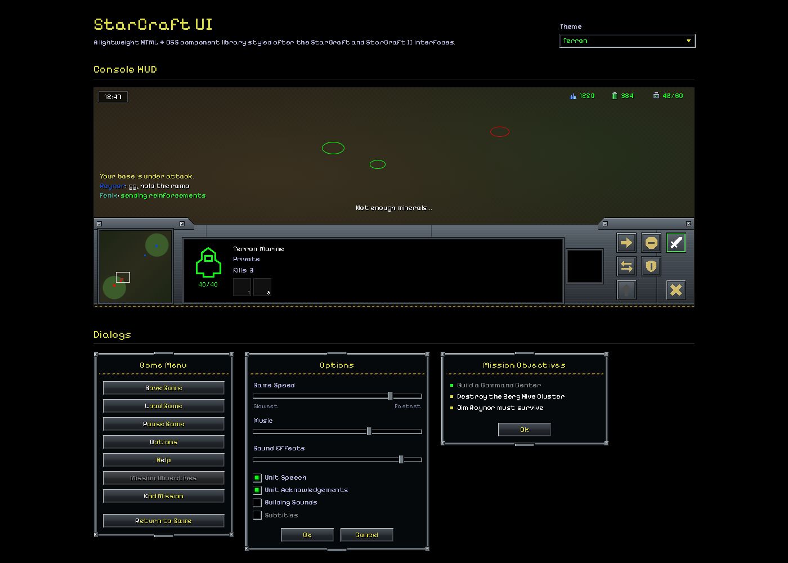
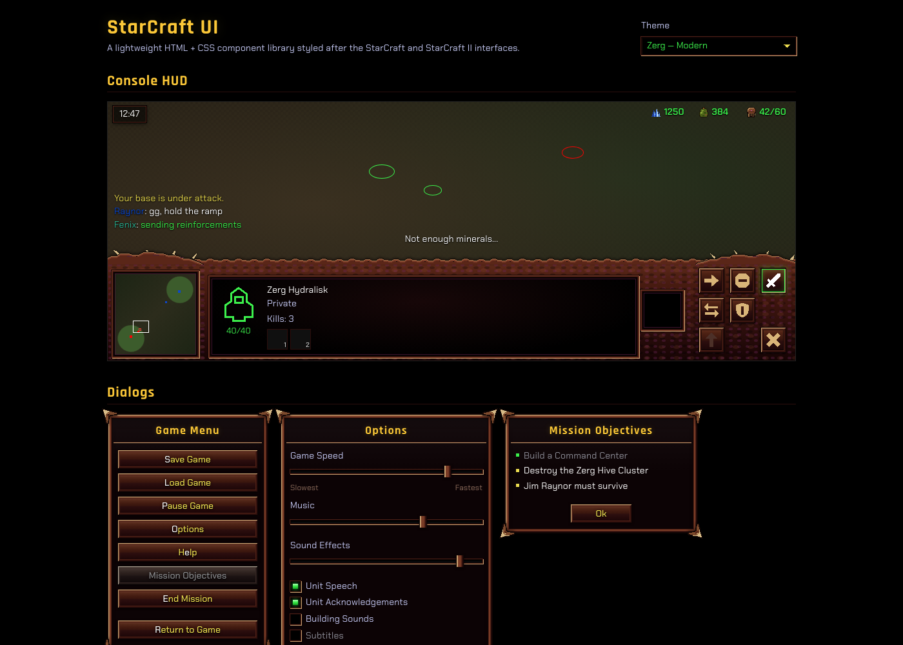
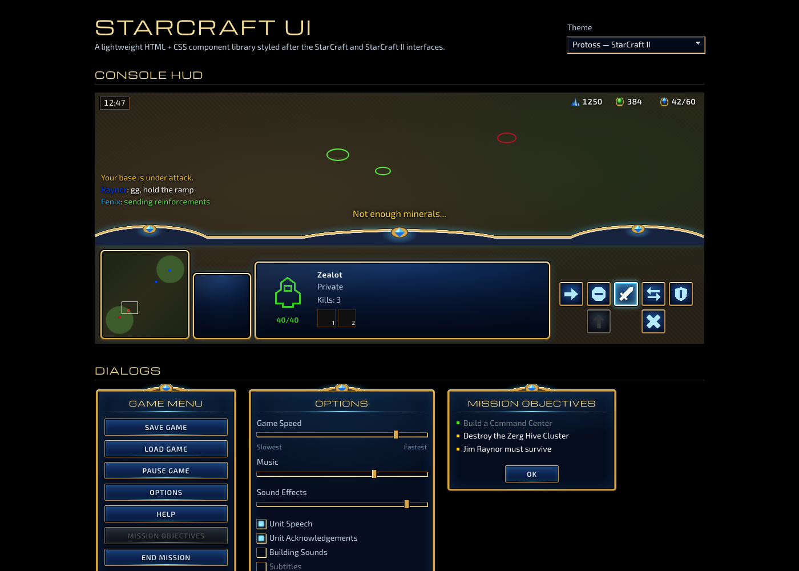

# StarCraft UI

A lightweight, dependency-free HTML + CSS component library styled after the StarCraft
interfaces, with **Terran**, **Zerg** and **Protoss** skins in three eras:

| Theme | Classes | Look |
| --- | --- | --- |
| Classic | `sc sc-terran` | StarCraft / Brood War (1998): pixel font, bevelled 640×480 frames |
| Modern | `sc sc-hd sc-terran` | The same SC1 skins with modern type, anti-aliasing and depth |
| StarCraft II | `sc sc2 sc2-terran` | StarCraft II HUD: 5×3 command card, SC2 palette and frames |

Swap `terran` for `zerg` or `protoss`. Open `index.html` for a live gallery of every component
(pick a theme from the dropdown, or link to `?theme=hd-zerg`, `?theme=sc2-protoss`, …).

## Screenshots

**Classic — Terran** (`?theme=terran`)



**Modern — Zerg** (`?theme=hd-zerg`)



**StarCraft II — Protoss** (`?theme=sc2-protoss`)



## Install

```html
<link rel="stylesheet" href="dist/starcraft.css">
<!-- optional web fonts; every theme falls back to system fonts -->
<link href="https://fonts.googleapis.com/css2?family=Chakra+Petch:wght@400;500;600;700&family=Exo+2:wght@400;500;600;700&family=Michroma&family=Orbitron:wght@500;700&family=Pixelify+Sans:wght@400;600&family=Rajdhani:wght@500;600;700&family=Saira+Condensed:wght@400;600&display=swap" rel="stylesheet">

<div class="sc sc-protoss sc-screen">
  …components…
</div>
```

`.sc` sets up the tokens and base type; add one race class (`sc-terran` default, `sc-zerg`, `sc-protoss`)
on the same element or any descendant to re-skin everything beneath it. Races can be mixed on one page.
Add the era class `sc-hd` (modern SC1) or `sc2` + `sc2-<race>` (StarCraft II) the same way.
Load only the fonts you use: classic uses Pixelify Sans; check `--sc-font` in `src/hd/` and `src/sc2/` for the others.

Add `.sc-x2` / `.sc-x3` for crisp integer pixel scaling (the original ran at 640×480).

## Build

`dist/` has one bundle per era (pick one) plus `starcraft.css` with everything:

| File | Themes | Minified |
| --- | --- | --- |
| `starcraft-classic.css` | Classic | ~47 KB |
| `starcraft-modern.css` | Classic + Modern | ~61 KB |
| `starcraft-sc2.css` | StarCraft II | ~65 KB |
| `starcraft.css` | All nine | ~94 KB |

Most of that weight is inline SVG icons and ornaments; it gzips well.

Sources live in `src/`: `core.css`, the classic skins in `races/`, the modern layer in `hd/`
and the StarCraft II layer in `sc2/` (each with a shared `base.css` plus one file per race). `sh build.sh` rebuilds the bundles in `dist/`.

## Components

| Area | Classes |
| --- | --- |
| Frames | `sc-panel`, `sc-frame`, `sc-well`, `sc-solid` |
| Dialogs | `sc-dialog`, `sc-dialog-title`, `sc-dialog-body`, `sc-dialog-actions` (`is-end`, `is-split`), `sc-backdrop` |
| Buttons | `sc-btn` (`sc-btn-sm`, `sc-btn-lg`, `sc-btn-block`), `sc-glue` (main-menu labels), `sc-menu` (F10 menu) |
| Hotkeys | `<span class="sc-hk">S</span>ave Game` |
| Forms | `sc-field`, `sc-label`, `sc-input`, `sc-textarea`, `sc-select`, `sc-check` (wrap a checkbox/radio + `<span>`), `sc-range`, `sc-scale`, `sc-chatline` |
| Lists | `sc-list` (`li.is-selected`, `.is-disabled`, `.is-header`, `.sc-list-meta`), `sc-scroll` |
| Tabs | `sc-tabs` › `sc-tab.is-active` |
| HUD | `sc-console` › `sc-minimap` (`sc-minimap-view`, `-dot`, `-ping`), `sc-info`, `sc-portrait` (`is-static`), `sc-cmd` |
| Commands | `sc-cmd-btn` (`is-selected`, `:disabled`), `sc-glyph sc-glyph-{move,stop,attack,patrol,hold,gather,return,build,cancel,rally,upgrade}` |
| Unit info | `sc-unit`, `sc-unit-wire`, `sc-unit-name`, `sc-unit-rank`, `sc-upgrades` › `sc-upgrade[data-level]`, `sc-selection` › `sc-sel` |
| Vitals | `sc-bar` (`is-mid`, `is-low`, `sc-bar-shield`, `sc-bar-energy`, `--value: 0–100`), `sc-stat`, `sc-progress` (`--value`) |
| Resources | `sc-resources` › `sc-res sc-res-{mineral,gas,supply}`; inline `sc-ico sc-ico-*` |
| Text | `sc-messages` › `sc-msg` (`is-system`, `is-ally`), `sc-msg-from`; `sc-notice`, `sc-timer`, `sc-tooltip`, `[data-sc-tip]`, `sc-transmission`, `sc-objectives` |
| Score | `sc-table`, `sc-scorebar` (`--value`) |
| Players | `sc-p1`…`sc-p8` set `--sc-player`; use with `sc-player-text`, `sc-player-swatch`, minimap dots, table rows |
| Colours | `sc-pale`, `sc-yellow`, `sc-white`, `sc-grey`, `sc-red`, `sc-green`, `sc-accent` |
| Game view | `sc-select-ring` (`is-enemy`, `is-neutral`), `sc-cursor`, `sc-cursor-enemy`, `sc-cursor-neutral` |

State classes (`is-hover`, `is-active`) mirror `:hover` / `:active` so states can be shown statically.

## Theming

Every colour is a custom property on `.sc` — override any of them, or write a new race:

```css
.sc-xelnaga {
  --sc-frame-hi: #e8f8ff; --sc-frame: #8aa8c0; --sc-frame-mid: #5a7890;
  --sc-frame-lo: #2a3c4c; --sc-frame-dark: #06080c;
  --sc-accent: #c0f0ff; --sc-glow: rgba(192,240,255,.5);
}
```

Text colours follow SC1's in-game font palette (pale blue default, `#dcdc3c` yellow, `#10fc18` green…)
and the eight original player colours.

Skin hooks for shaped parts (all optional):

| Token | Purpose |
| --- | --- |
| `--sc-console-rim` | Height of a see-through band at the console's top; draw the race silhouette into it with `.sc-console::before` |
| `--sc-console-edge` | The 2px line at the rim (`none` to drop it) |
| `--sc-console-texture` | Extra image layer(s) over `--sc-console-bg` |
| `--sc-title-rule` | Background under `.sc-dialog-title` |
| `--sc-cmd-bg`, `--sc-cmd-bg-hover`, `--sc-cmd-bg-active` | Command-card button fills (default to the `--sc-btn-bg*` tokens) |
| `--sc-screen-shadow` | Bevel ring around the minimap, info panel and portrait |
| `--sc-tooltip-bg`, `--sc-tooltip-border` | Tooltip fill and border |
| `--sc-cmd-cols`, `--sc-cmd-size` | Command-card columns (3 in SC1, 5 in SC2) and button size |
| `--sc-btn-px` | Button side padding (the pressed state nudges the label from it) |

`.sc-panel`, `.sc-dialog`, `.sc-frame` and `.sc-console` leave `::before` / `::after` free for race ornaments.

## Notes

StarCraft is a trademark of Blizzard Entertainment. This project contains no game assets: all
frames, icons and glyphs are drawn with CSS gradients and small inline SVGs. Supply your own
wireframes/portraits as `` inside `sc-unit-wire`, `sc-sel`, `sc-portrait`, `sc-cmd-btn`.
